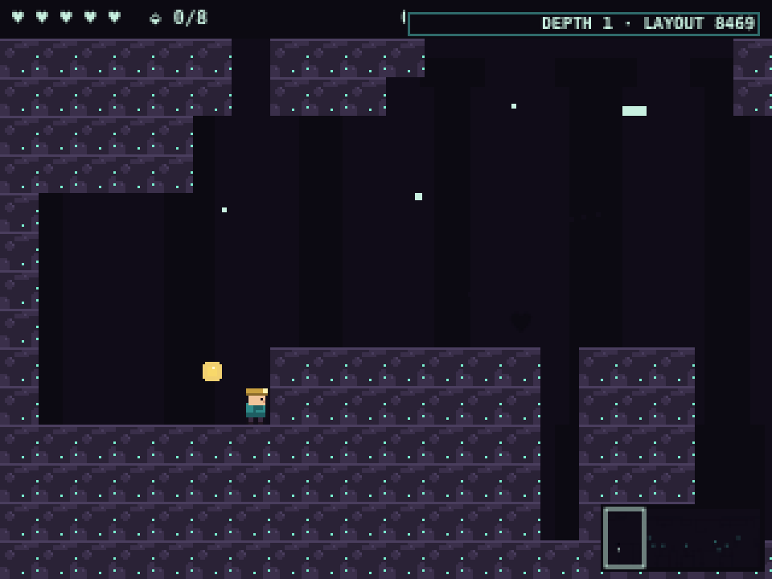
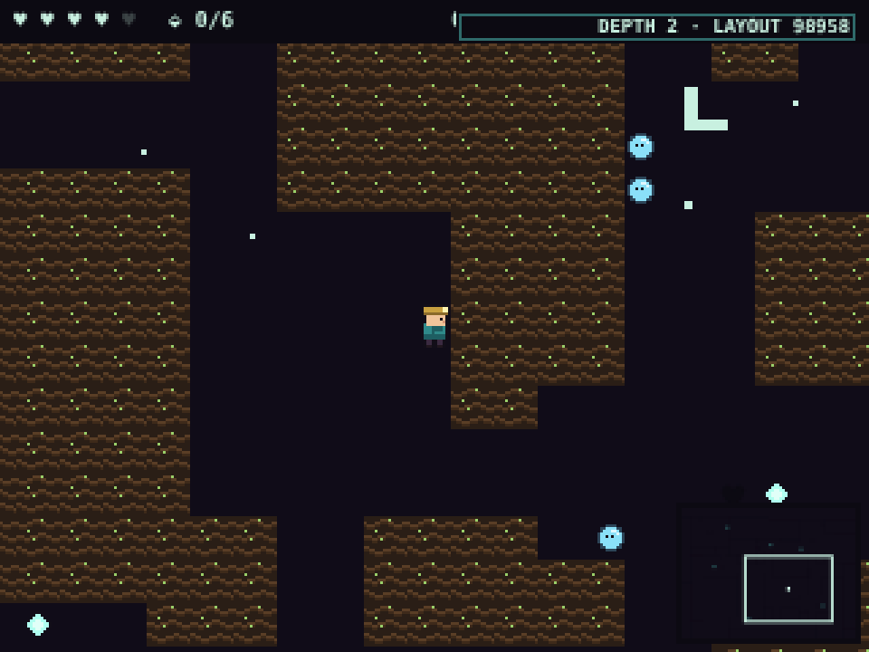
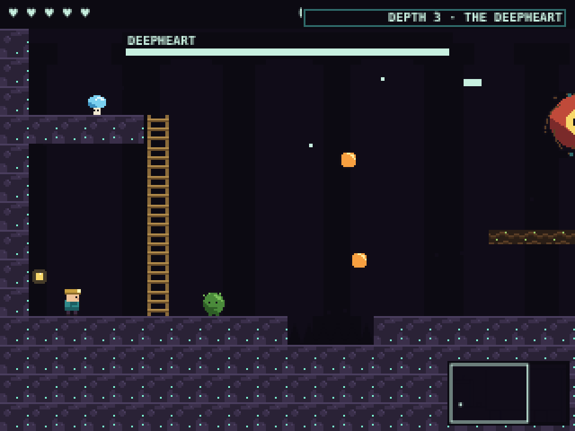
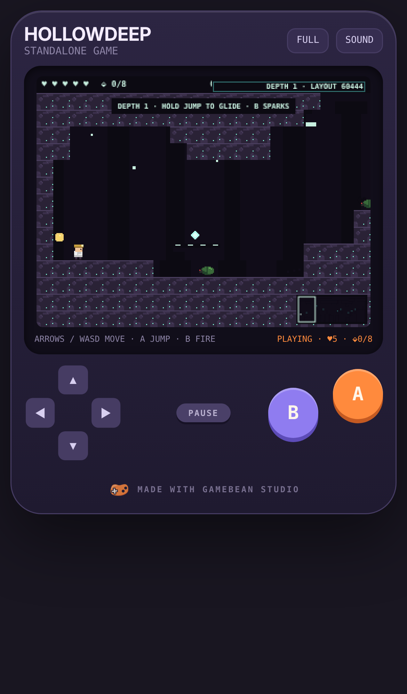

# Hollowdeep

A roguelite descent made with [GameBean Studio](https://github.com/icakinser/gamebean-studio). Wick the lamp-miner climbs down through three depths to wake the Deepheart. The first two depths are built new every play by the Level makers; the third is the boss's den.

## Play

- **In a browser:** download `index.html` and open it. On a phone, use the on-screen pad and A / B.
- **In GameBean Studio:** **FILE > Open…** > **Browse this computer…** and pick `hollowdeep-cartridge.json` (or `index.html`) to open it in the editor. It is also under **Full games** in **FILE > New Game…**.

The controls are listed under **Controls in the finished game** below.

| | |
| --- | --- |
|  |  |
|  |  |

---

## Build it yourself

**Hollowdeep** is a roguelite descent. **Wick** the lamp-miner climbs down into the hollow under the hill, through three depths, to wake the **Deepheart**. The first two depths are **new every play**: the **Level makers** build them each time the scene starts. The third is a den built by hand, with the boss.


1. **Depth 1, the Glowing Shaft:** a side-view cave run from the **Cave maker**. Jump the spike pits, collect relics and reach the tunnel at the far end.
2. **Depth 2, the Root Halls:** a top-down maze from the **Dungeon maker**. Find the key, open the locked room and leave.
3. **Depth 3, the Deepheart's den:** ladders, a lift and a fire bar, two friendly cave folk, and the boss.

The cave folk you place **inside a maker's area** are its examples: every enemy it makes is a copy of one of them, picked at random. So you design four creatures once, and every play mixes them differently.

It shows off the beans no other game used: **Glide**, **Core magnet**, **Homing shot**, **Invulnerability window**, **Follower**, **Swoop**, **Keep distance**, **Timed dash**, **Flee**, **Explode on contact**, **Checkpoint aura**, **Healing aura**, **Ladder**, **Platform path**, **Orbit**, **Boss phases**, **Camera focus**, **Camera zoom**, **Hit stop**, **Slow motion** and **Music zone**, plus a spawner that makes copies of an **entity** from your library.

**What you will learn:** the Level makers and their examples, a hero that changes between side view and top-down, a hand-built boss arena, and spawning entities.

**Time:** about 60 minutes.

---

## Before you start

### Learn the editor moves

If you have not used the GameBean Studio editor before, read **[GameBean Studio editor basics](EDITOR-BASICS.md)** first. The moves you will repeat most:

| The tutorial says                           | You do                                                                                                                    |
| ------------------------------------------- | ------------------------------------------------------------------------------------------------------------------------- |
| **Place a Bat**                             | Toolbox > **OBJECTS** tab > click **Bat** > click the map > click **DONE** ([§8](EDITOR-BASICS.md#8-place-an-object))     |
| **Name it Cave bat, at `160, 96, 16 × 12`** | Type the name, then X, Y, W and H ([§9](EDITOR-BASICS.md#9-name-an-object-and-type-its-position-and-size))                |
| **Remove Chase**                            | Click the **×** on the Chase card ([§10](EDITOR-BASICS.md#10-bean-cards-turn-off-reorder-remove-and-change-settings))     |
| **Add Swoop (Actions)**                     | **ADD ACTION** > type "Swoop" > click **Swoop** ([§11](EDITOR-BASICS.md#11-add-a-bean))                                   |
| **Sprite `bat/idle-1.png`**                 | **SPRITE** > **IMPORT PNG / SHEET** > pick the file > **SAVE SPRITE** ([§15](EDITOR-BASICS.md#15-sprites-import-or-draw)) |
| **Save it as an entity**                    | **SAVE ENTITY** in the inspector ([§16](EDITOR-BASICS.md#16-save-an-object-as-an-entity-and-place-copies))                |

### Get the sprite files

The pictures are in [`sprites/hollowdeep`](sprites/hollowdeep). Frames of one animation are numbered (`idle-1.png`, `idle-2.png`): import frame 1, **DUPLICATE FRAME**, import frame 2.

| Folder                                     | Used by                                                            |
| ------------------------------------------ | ------------------------------------------------------------------ |
| `wick` (`idle`, `move`, `jump`, `hurt`)    | Wick                                                               |
| `rock`, `root`                             | Cave walls (Depth 1 and 3) and root walls (Depth 2), 16 × 16 tiles |
| `ladder`, `lift`, `firebar`                | The den's ladder tiles, lift and fire orbs (and the Ember mites)   |
| `bat`, `puffcap`, `wisp`, `beetle`, `moth` | The cave folk                                                      |
| `mote`, `relic`                            | Wick's little light; the relics (cores)                            |
| `mosskin`, `healcap`                       | The two friends in the den                                         |
| `deepheart` (`idle`, `hurt`)               | The boss                                                           |

### Keep the finished game open for comparison

**FILE > New Game…** > **HOLLOWDEEP** (under Full games) in a second window. Play it a couple of times and see the first two depths change.

### Controls in the finished game

| Key or touch  | Does                                         |
| ------------- | -------------------------------------------- |
| Left / Right  | Run (Depth 2: arrows walk in all directions) |
| Z / Space / A | Jump. Hold it while falling to glide         |
| X / B         | Fire a seeker spark at the nearest creature  |
| Up / Down     | Climb a ladder                               |
| Enter         | Pause                                        |

---

## Part 1: Set up the game

1. **BUILD** > **FILE > New Game…** > **BLANK GAME**. Name the scene **THE GLOWING SHAFT**. **W** = 1280, **H** = 240 (80 tiles by 15).
2. **LEVEL SETTINGS**: **CAMERA** = **Follow player**, **SKY** = **Night**, **HORIZON** = **Cavern**, **WEATHER** = **Embers**, **INTRO** = `DEPTH 1 · HOLD JUMP TO GLIDE · B SPARKS`.
3. A palette **Hollowdeep**: Ink `#0c0a12`, Dark `#100c18`, Light `#2f6a6a`, Paper `#c8f0e0`. With the Night sky, Dark is the cave's black.
4. **VARIABLES**: slot 1 `layout` (0), slot 2 `depth` (1). The makers write their layout number into slot 1.
5. **SOUNDS**: Sound 1 **Seeker spark** (a **Laser**), Sound 2 **Puff boom** (a **Boom**).
6. **MUSIC**: **Into the Hollow** (tempo 112, **PLAYS AS** = **Song 1 + Main theme**) and **Deepheart** (tempo 138, **PLAYS AS** = **Song 2 only**), from **Surprise me** in a minor key.

---

## Part 2: Wick and Mote


1. Click the **Hero**. Name it **Wick**, `12 × 16`. Keep **Gravity**, **Run**, **Jump**, **Stomp attack**, **Core collector**, **Exit reader**, **Checkpoint reader**, **Heart collector** and **Damage + respawn**; remove **Double jump**, **Dash** and **Dash attack**.
2. Settings: **Run** > Top speed 96. **Jump** > Power 270. **Damage + respawn** > Max hearts 5.
3. Add these (Actions):

   | Bean                       | Settings                                         | What it does                                           |
   | -------------------------- | ------------------------------------------------ | ------------------------------------------------------ |
   | **Glide**                  | Fall speed 48                                    | Hold jump while falling to drift down slowly           |
   | **Homing shot**            | Speed 150, Turn rate 5, Range 200, Interval 0.45 | B fires a spark that steers into the nearest creature  |
   | **Core magnet**            | Range 56, Pull speed 110                         | Relics nearby float to Wick, even through walls        |
   | **Invulnerability window** | Duration 2                                       | Two safe seconds when each depth starts                |
   | **Environment settings**   | **Pixel sprites** = Flip to face movement        | Wick looks left when running left (for the whole game) |

4. **Sprite**: `wick/idle-1…2`, `move-1…4` (FRAME TIME 0.14), `jump`, `hurt-1…2`.
5. **Mote**: a **Spikes** at `32, 40, 10 × 10`. Remove **Hazard** (a Spikes with no Hazard is harmless). Add **Follower**: Stay behind by 18, Float above by 14, Catch-up speed 5. Sprite `mote/idle-1…2`.

---

## Part 3: Depth 1, the Cave maker

### 3.1 The maker

1. Place a **Brick**: **Level maker**, at `0, 0, 16 × 16`. Its top-left corner is the corner of the cave.
2. Add **Cave maker** (Actions):

   | Setting                    | Value                 |
   | -------------------------- | --------------------- |
   | Width (tiles) / Height     | 80 / 15               |
   | Style                      | Cave (with a ceiling) |
   | Spike pits                 | Some                  |
   | Spikes to jump             | 4                     |
   | Cores / Enemies / Hearts   | 8 / 9 / 2             |
   | Layout (0 = new each play) | 0                     |
   | Layout number in           | Variable 1            |

3. **Sprite** `rock/idle.png`, **ON BIG OBJECTS** = **Repeat as tiles**. The maker lends its look to every wall it builds.

### 3.2 The cave folk (the examples)

Place these **inside the maker's area** (anywhere in the 1280 × 240 scene works). Each one's beans are replaced by the list given, so remove the kind's own beans first.

| Name        | Kind   | At                  | Beans (Actions)                                                                                                                                                                                | Sprite                    |
| ----------- | ------ | ------------------- | ---------------------------------------------------------------------------------------------------------------------------------------------------------------------------------------------- | ------------------------- |
| Cave bat    | Bat    | `160, 96, 16 × 12`  | **Swoop** (Sight range 96, Dive speed 150, Return speed 70, Rest 0.8), **Health pool** 1, **Touch damage**, **Stompable**                                                                      | `bat` (FRAME TIME 0.15)   |
| Puffcap     | Hopper | `192, 96, 14 × 14`  | **Gravity**, **Hop** (Power 160, Interval 1.6), **Explode on contact** (Damage 1), **Health pool** 1, **Sound cue** (Sound 2, When = This is destroyed)                                        | `puffcap`                 |
| Wisp        | Bat    | `224, 96, 12 × 12`  | **Hover** (Distance 10, Speed 2), **Keep distance** (Speed 36, Minimum 64, Maximum 120), **Homing shot** (Speed 60, Turn rate 1.6, Range 150, Interval 3), **Health pool** 2, **Touch damage** | `wisp`                    |
| Root beetle | Walker | `256, 96, 16 × 12`  | **Gravity**, **Patrol** (Speed 24), **Timed dash** (Interval 2.2, Speed 150), **Health pool** 2, **Touch damage**, **Stompable**                                                               | `beetle` (`idle`, `move`) |
| Relic       | Core   | `300, 100, 10 × 10` | **Collectible core** (Points 250)                                                                                                                                                              | `relic`                   |

The bat waits and dives at you; the Puffcap bursts when it touches you; the Wisp keeps its distance and fires slow seekers; the beetle dashes every couple of seconds.

### 3.3 The layout label

A **Spikes**: **Depth label**, at `168, 4, 148 × 12`. Remove Hazard. Add **Label** (Text size Small, Align Right, Look Dark box). UI TEXT `DEPTH 1 · LAYOUT {layout}`. Players can tell each other the number of a good cave: typing it in the maker's **Layout** setting plays that cave again.

> **Check:** **PLAY** a few times. The cave is different each time, filled with your four creatures, and Wick starts at its left end. Hold jump while falling to glide across the pits.

---

## Part 4: Depth 2, the Dungeon maker


1. **+ NEW SCENE**: **THE ROOT HALLS**, **W** 640, **H** 480. **CAMERA** Follow player, **SKY** Night, **HORIZON** None, **INTRO** `DEPTH 2 · FIND THE KEY · B SPARKS`, Hollowdeep palette.
2. **Level maker**: a **Brick** at `0, 0`, sprite `root/idle.png` (Repeat as tiles), with **Dungeon maker**: Width 40, Height 30, Rooms 8, Cores 6, Enemies 9, Hearts 2, **Key and door** Yes, **Layout number in** Variable 1.
3. **Wick, top-down:** copy Wick from Depth 1 (**Ctrl+C**, then **Ctrl+V** here). Remove **Gravity**, **Run**, **Jump**, **Glide** and **Stomp attack**, add **Top-down move** (Top speed 96), and set **Damage + respawn** > Knockback 90. Copy **Mote** too.
4. The hall folk, inside the area:

   | Name         | Kind   | At                 | Beans                                                                                                            | Sprite   |
   | ------------ | ------ | ------------------ | ---------------------------------------------------------------------------------------------------------------- | -------- |
   | Root beetle  | Chaser | `96, 48, 16 × 12`  | **Chase 2D** (Speed 34, Range 96), **Timed dash** (Interval 2.4, Speed 140), **Health pool** 2, **Touch damage** | `beetle` |
   | Glimmer moth | Chaser | `128, 48, 14 × 12` | **Flee** (Speed 52, Range 90), **Health pool** 1                                                                 | `moth`   |
   | Wisp         | Bat    | `160, 48, 12 × 12` | **Keep distance**, **Homing shot**, **Health pool** 2, **Touch damage** (as in Depth 1)                          | `wisp`   |
   | Relic        | Core   | `200, 52, 10 × 10` | **Collectible core** 250                                                                                         | `relic`  |

   The moth is harmless and runs away: catch it with a spark for points.

5. Copy the **Depth label** and change it to `DEPTH 2 · LAYOUT {layout}`.

---

## Part 5: Depth 3, the Deepheart's den


### 5.1 The room

**+ NEW SCENE**: **THE DEEPHEART'S DEN**, **W** 480, **H** 240, Follow player, Night sky, Cavern horizon, Embers, Hollowdeep palette, INTRO `DEPTH 3 · STOMP OR SPARK THE DEEPHEART`.

Paint it with the Brush ([§18](EDITOR-BASICS.md#18-paint-walls-quickly-with-the-brush)) as **Brick**s with the `rock` tile picture. One character is one 16 × 16 tile: `#` rock, `=` a root ledge (**Platform**, `root` tile), `L` ladder, `^` spikes, `@` Wick, `M` Mosskin, `H` Healcap, `F` the fire bar's middle:

```text
##############################
#............................#
#............................#
#..H.........................#
#####L...............=====...#
#....L.......................#
#....L.......................#
#....L......F................#
#....L...........====........#
#....L.......................#
#.@..L.M.....................#
##########^^^#########^^^#####
##############################
##############################
##############################
```

- **Ladder**: a **Spikes** at `80, 64, 16 × 112` with Hazard removed, **Ladder** (Climb speed 80), sprite `ladder/idle.png` (Repeat as tiles). Up and Down climb it; at the top Wick steps onto the ledge.
- **Spikes**: **Spikes** objects (as they come) in the two pits.

### 5.2 The moving parts

1. **Root lift**: a **Mover** at `416, 168, 48 × 8`, sprite `lift`, with **Solid** and **Platform path** (Speed 40, Path Back and forth, **Starts** = When the hero stands on it, Offset Y -104). It carries Wick up to the high ledge.
2. **Fire orb 1**: a **Spikes** (keep its Hazard) at `192, 112, 10 × 10`, sprite `firebar`, with **Orbit** (Radius 28, Speed 110, Start angle 0). **Fire orb 2**: a copy with **Start angle** 180. Two orbs circling the same spot make a fire bar.

### 5.3 The friends

1. **Mosskin**: a **Walker** at `112, 160, 14 × 16`, sprite `mosskin`. Remove all its beans, then add **Gravity** and **Checkpoint aura**. Touch it once to make it your respawn point.
2. **Healcap**: a **Walker** on the high ledge at `48, 52, 12 × 12`, sprite `healcap`. Remove all its beans, add **Healing aura**. It heals Wick once (or gives points at full health).

### 5.4 The Ember mite (an entity)

1. Place a **Hopper** anywhere: **Ember mite**, `10 × 10`, sprite `firebar`. Beans: **Gravity**, **Hop** (Power 200, Interval 1.1), **Patrol** (Speed 30), **Health pool** 1, **Touch damage**, **Stompable**.
2. **SAVE ENTITY**, then delete the placed one. The mites only appear when the nest makes them.
3. **Mite nest**: a **Spikes** at `352, 32, 16 × 16`, Hazard removed, see-through sprite. Add **Timer** (`Initial delay = 0.5`, `Repeat every = 4`, `Run count (0 = ∞) = 0`); in its **RUN THESE BEANS** area open **Add a bean to run…** and pick **Spawn entity** (`Max alive = 3`) ([§13](EDITOR-BASICS.md#13-beans-that-run-other-beans-key-input-timer)). **SPAWN KIND** (under the X, Y, W, H boxes) = **Ember mite** (under **My entities**). Rule: `WHEN On start · TARGET self · DO Deactivate target`: the nest sleeps until the boss wakes it.

### 5.5 The Deepheart

1. Place a **Bat**: **Deepheart**, at `320, 48, 40 × 40`, sprite `deepheart` (`idle`, `hurt`). Remove **Chase**, keep **Hover** and **Touch damage**, remove **Stompable**. Settings and beans:

   | Bean            | Settings                                                    |
   | --------------- | ----------------------------------------------------------- |
   | Hover           | Distance 56, Speed 0.9, Path = Side to side                 |
   | Health pool     | Health 24                                                   |
   | Boss phases     | Phase 2 at 60, Phase 3 at 25, Speed-up 1.4, Flash and shake |
   | Boss health bar | Show within 320                                             |
   | Homing shot     | Speed 70, Turn rate 2, Range 260, Interval 2.2              |
   | Radial burst    | Projectiles 8, Speed 70, Spin per burst 20, Interval 3.4    |
   | Hit stop        | Duration 0.06, When = This takes damage                     |
   | Slow motion     | Game speed 0.35, Lasts 1.6, When = This is destroyed        |
   | Camera zoom     | Zoom 1.6, Duration 1.2, When = This is destroyed            |
   | Camera focus    | Hold for 1.6, When = Scene start                            |
   | Sound cue       | Sound 1, When = This takes damage                           |

   Camera focus shows the boss for a moment when the den opens; slow motion and zoom make the last hit feel big.

2. Rules:
   - `WHEN On message (phase2) · TARGET named (Mite nest) · DO Activate target`. Boss phases sends `phase2` at 60% health.
   - `WHEN On destroyed · DO Give score (5000), Wait (1.8), Win / lose the game (win, THE DEEP GLOWS AGAIN)`.
3. **Den music**: a **Spikes** at `144, 16, 320 × 176`, Hazard removed, see-through sprite, with **Music zone** (Track = **Song 2**, Leaving = Back to the music before). The Deepheart song plays in the arena.
4. Copy **Wick** and **Mote** from Depth 1 to the `@` spot (`34, 160`), and add a **Depth label**: `DEPTH 3 · THE DEEPHEART`.

---

## Part 6: Play it

1. **PLAY**. Run and glide through the shaft. Press **B** to fire sparks: they curve into the nearest creature.
2. In the Root Halls, find the key and the locked room, then the exit.
3. In the den, climb the ladder for the Healcap, touch Mosskin to save your place, and fight the Deepheart from the ledges. Spark it, or stomp it from above.

> **If something is off:** the cave has the built-in walker instead of your creatures? The examples must be **inside** the maker's area. Wick falls through the den? Its rock must be **Brick**s. The mites never come? The nest needs **Spawns** = Ember mite, and the boss's phase2 rule must target the nest. The lift doesn't move? Platform path needs a **Mover** with **Solid**.

---

## Make it your own

- **Deeper:** add a fourth depth with the **Maze maker** or **Box puzzle maker** between the halls and the den.
- **A fixed cave for a speedrun:** type a layout number into the Cave maker's **Layout**, so everyone plays the same one.
- **New creatures:** place a fifth example in the maker's area (a turret? a swooping moth?) and it joins the mix.
- **A harder boss:** more Health pool, a shorter Homing shot interval, or Phase 3 at 40 with a third message rule.
